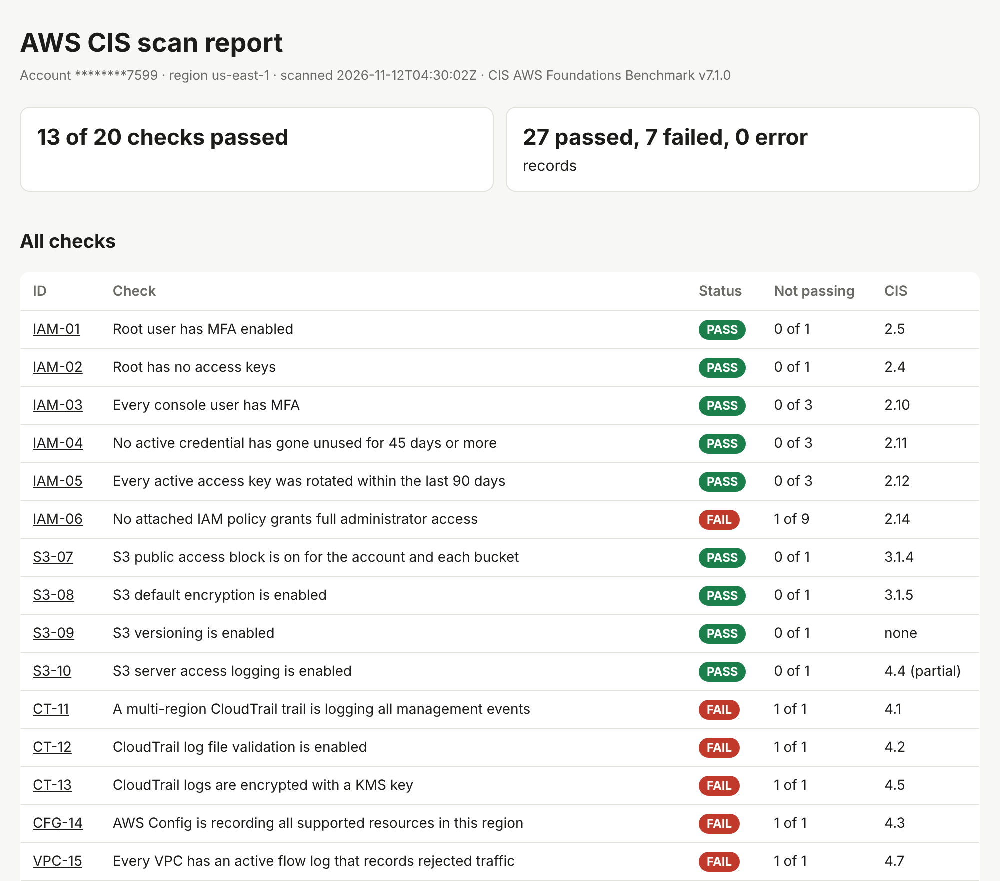

# aws-cis-scanner


A read-only Python/boto3 command-line scanner. It checks an AWS account against 20 controls taken from
the **CIS AWS Foundations Benchmark v7.1.0**, writes one structured evidence record per result, and builds
a one-page HTML report. Every check is mapped to NIST 800-53 Rev 5, ISO/IEC 27001:2022 and SOC 2.

**Scenario:** you are the first compliance engineer at a 50-person SaaS company preparing for a SOC 2 and
ISO 27001 audit. Today the evidence is screenshots. This replaces them with one command that produces
dated, machine-readable, re-runnable evidence.



## Quick start

```powershell
python -m venv .venv
.venv\Scripts\Activate.ps1          # macOS/Linux: source .venv/bin/activate
pip install -e ".[dev]"
scanner run --profile audit         # prints one line per check, then writes evidence + report
pytest -q; ruff check .             # 100 tests, no real AWS account needed
```

Options: `--region us-east-1` (default), `--output evidence`, `--only IAM-01 --only S3-07`.
Each run writes a new folder `evidence/<UTC time>/` with one JSON file per check and `report.html`.

**Use a read-only identity.** Create a dedicated IAM user with the AWS managed policies `SecurityAudit`
and `ViewOnlyAccess` and no group memberships. Never use an admin user.

## What it checks

| Area | Checks | Examples |
|------|--------|----------|
| IAM (7) | IAM-01 to IAM-06, IAM-20 | root MFA, root access keys, MFA for console users, unused credentials (45 days), key rotation (90 days), full-admin policies, password policy |
| S3 (4) | S3-07 to S3-10 | public access block, default encryption, versioning, access logging |
| CloudTrail (3) | CT-11 to CT-13 | multi-region trail logging, log file validation, KMS encryption |
| Config (1) | CFG-14 | Config recorder on for all supported resources |
| VPC (4) | VPC-15 to VPC-18 | flow logs, default security group closed, SSH and RDP not open to 0.0.0.0/0 |
| KMS (1) | KMS-19 | automatic rotation on customer-managed keys |

The full table, with the CIS recommendation number, NIST, ISO and SOC 2 reference, and **the reason each
mapping holds** is in [docs/mapping.md](docs/mapping.md). The mapping is a judgment, not an official
crosswalk, so every row says why.

## An evidence record

```json
{
  "check_id": "IAM-06",
  "title": "No attached IAM policy grants full administrator access",
  "status": "FAIL",
  "resource": "arn:aws:iam::aws:policy/AdministratorAccess",
  "region": "us-east-1",
  "account_id": "123456789012",
  "timestamp": "2026-11-12T03:28:34Z",
  "controls": {
    "cis": "CIS AWS Foundations Benchmark v7.1.0, 2.14",
    "nist_800_53_r5": "AC-6",
    "iso_27001_2022": "A.8.2",
    "soc2": "CC6.3"
  },
  "evidence": {
    "allows_everything": true,
    "attached_to": { "users": [], "groups": ["Admin"], "roles": [] }
  },
  "remediation": "Detach the policy from every user, group and role, then delete or narrow it."
}
```

One record per resource (user, bucket, trail, security group, VPC, key), so each one is its own evidence.
Status is `PASS`, `FAIL` or `ERROR` (the check could not run, for example a permissions problem).
A failing AWS call becomes an `ERROR` record. It never crashes the scan.

## What it found in a real account

I ran it against my own AWS lab account (account number masked in everything shown, including the
report). First full scan (all 20 checks): **10 of 20 checks passed, 11 findings.** After the fixes below: **13 of 20.**

**Fixed, with before and after evidence**

- **VPC-17, SSH open to the world.** The scan found the security group `launch-wizard-1` allowing TCP 22
  from `0.0.0.0/0` (an EC2 wizard default). I deleted the unused group and
  re-ran nine minutes later: VPC-17 went from FAIL to PASS.
- **S3-07, public access block.** The first scan (November 9) found all four account-level S3 Block
  Public Access settings switched off, so nothing stopped a bucket from being made public by mistake.
  I turned all four on, and the next scan, ten minutes later, returned PASS with all four settings
  `True`. It has passed on every scan since.
- **IAM-03, IAM-04 and IAM-20, users and passwords.** The scan found two users with a console password
  and no MFA (IAM-03), one of them unused for 86 days (IAM-04), and no custom password policy (IAM-20).
  I disabled console sign-in for both users, since nobody used it, and set a 14-character minimum with
  a 24-password history. IAM-20 passed on the next scan. IAM-03 and IAM-04 passed on the scan after
  AWS refreshed its credential report (AWS caches it for up to 4 hours).

Result after the fixes: **13 of 20 checks passed** (27 of 34 records), up from 10 of 20.

**Kept on purpose (accepted risk)**

- **IAM-06, `AdministratorAccess` attached to the group `Admin`.** This is how I administer the lab
  account, so I did not remove it. The scanner flags it anyway, which is correct: CIS wants least
  privilege. A real programme would record the exception, its owner, the reason, and the compensating
  controls, such as MFA and no long-lived access keys for the people in that group.

**Not set up in this account, so they still fail**

CloudTrail (CT-11, CT-12, CT-13), AWS Config (CFG-14), VPC flow logs (VPC-15) and the default security
group rules (VPC-16). They cost a little to run, and the point of a scanner is to say so plainly rather
than hide it.

## Design decisions

- **Read-only.** It only calls `Get*`, `List*` and `Describe*` APIs. One call, `iam:GenerateCredentialReport`,
  asks IAM to prepare its own report and changes nothing in the account. Tests run against `moto`, a fake
  AWS, so they can never touch a real account.
- **"No data" never passes.** If AWS cannot answer, or a needed value is missing, the result is `ERROR`
  or `FAIL`, never `PASS`. No CloudTrail trail, no Config recorder and no password policy are all `FAIL`.
- **Honest about empty accounts.** With no S3 buckets or no customer-managed KMS keys there is nothing
  to judge, so those checks pass. In my lab account that is the case for S3-07 to S3-10 and KMS-19, so
  the "10 of 20" is a little kinder than it looks.
- **Regions.** IAM and S3 are account-wide. Config, VPC, security groups, KMS and CloudTrail trails are
  read for the one region given by `--region`. Run it once per region to cover an account. Every
  record carries its region.
- **Strict where CIS is loose.** For example VPC-15 requires flow logs that record rejected traffic, and
  S3-07 fails a bucket with no setting of its own even if the account level protects it. Each case is
  written down in `docs/mapping.md`.
- **Tested with failing inputs.** Every check has at least one test that builds a bad configuration and
  expects a `FAIL`. 100 tests, run in CI on every push.
- **Masked on screen.** The console and the HTML report show the account number as `********1234`.
  Raw evidence files keep the full number, so `evidence/` is git-ignored and never committed.

## Limits

- Covers 20 controls, not the whole benchmark. Several CIS recommendations are manual and not covered.
- IPv6 rules (`::/0`) are not checked (CIS 6.4). Inline IAM policies are not judged by IAM-06
  (CIS 2.14 does not audit them either).
- One region per run. No multi-account or AWS Organizations support yet.
- IAM-03, IAM-04 and IAM-05 read the IAM credential report, which AWS refreshes at most every 4 hours,
     so they can lag a change by up to 4 hours. Each of their evidence records carries `report_generated`,
     the time of the report it read.
- The NIST, ISO and SOC 2 columns are my mapping. They are evidence pointers, not a certification.
- Passing these checks does not make an account secure or an audit pass.

## How to add a check

1. Add a function to the right file in `scanner/checks/` and decorate it with `@check(...)`.
2. Give it its control IDs (CIS, NIST, ISO, SOC 2) and a remediation line.
3. Return one `Finding` per resource.
4. Write a passing test and a failing test in `tests/`. Add the reason for the mapping to `docs/mapping.md`.

## Ideas for next

`--all-regions`, IPv6 rules for VPC-17 and VPC-18, more CIS recommendations, and a diff between two runs
to show drift.

## Sources

- CIS Amazon Web Services Foundations Benchmark v7.1.0 (recommendation numbers only; the benchmark
  text is not included, see CIS terms of use)
- NIST SP 800-53 Rev 5
- ISO/IEC 27001:2022, Annex A
- AICPA SOC 2 Trust Services Criteria
